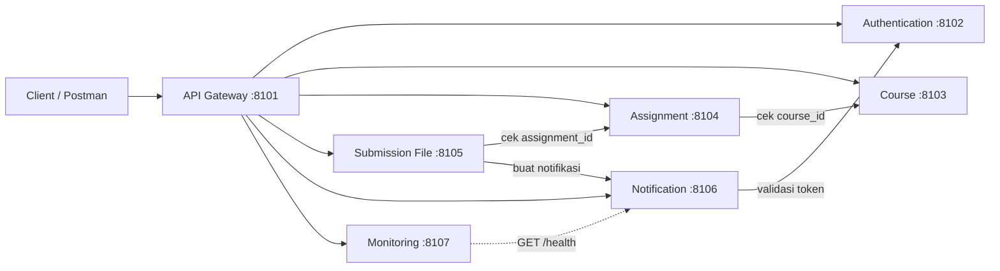
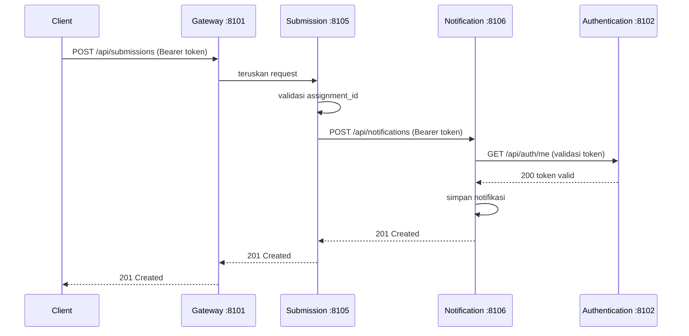
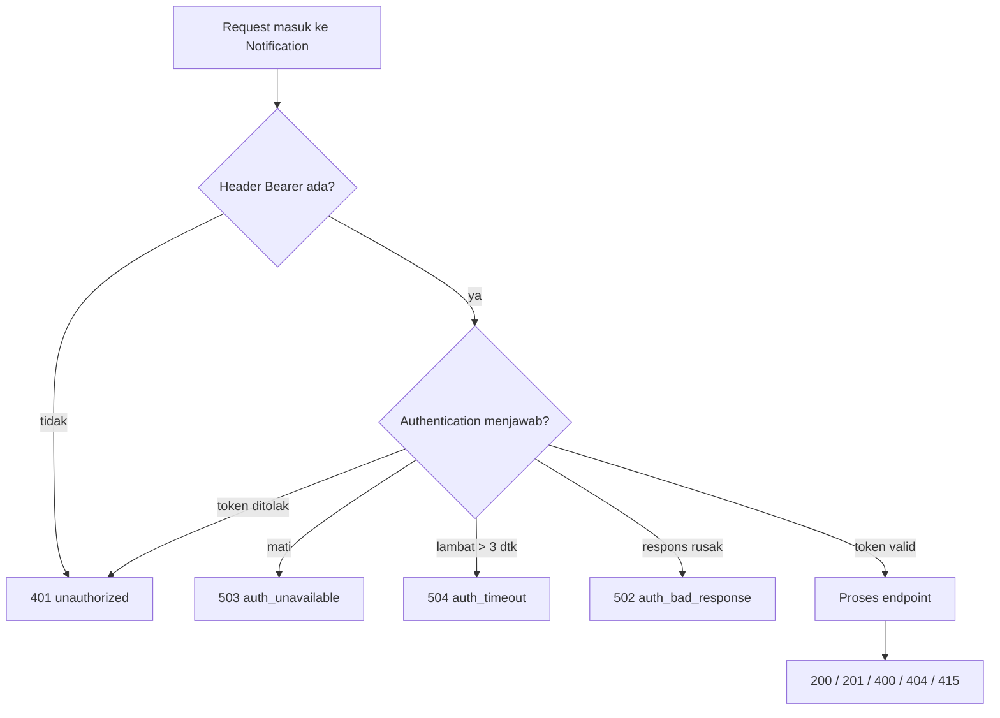

# Diagram Notification Service

Diagram ditulis dengan Mermaid (tampil otomatis di GitHub). Untuk tugas, ekspor juga sebagai gambar
(mis. buka https://mermaid.live, tempel kode, lalu **Download PNG**) dan simpan di `docs/bukti/`.

## 1. Hubungan antarservice

## 2. Alur request: pengumpulan berhasil menghasilkan notifikasi

## 3. Penanganan kegagalan

